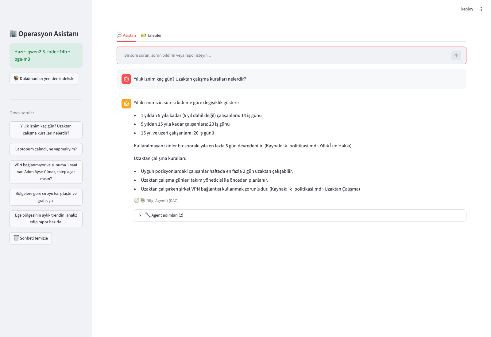
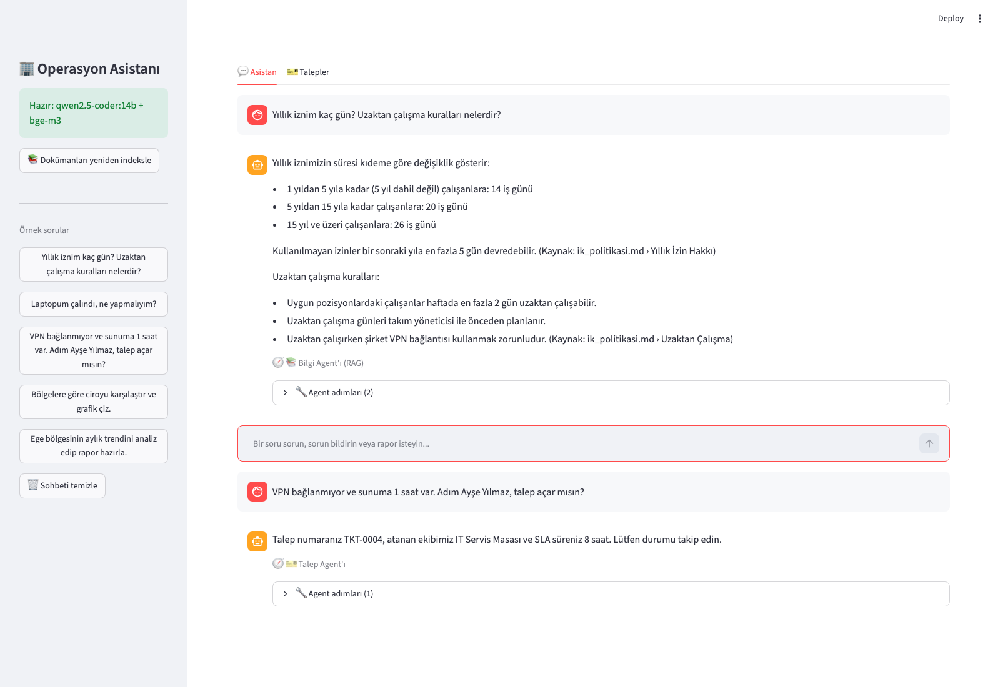
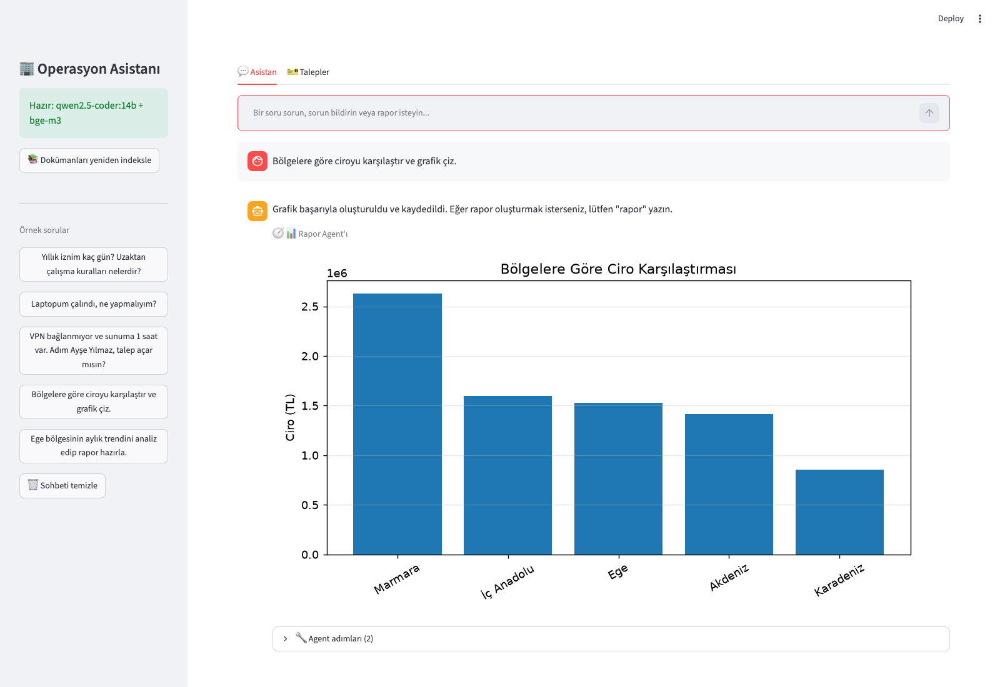
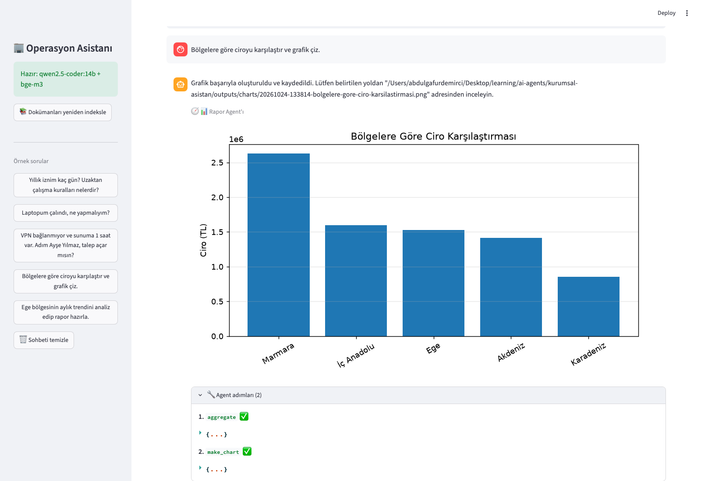
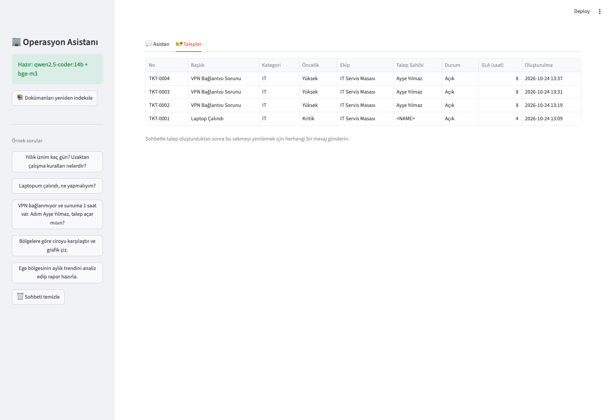

# 🏢 Kurumsal Operasyon Asistanı (Agentic AI)

Tek bir sohbet arayüzünden **3 farklı kurumsal sorunu** çözen, tamamen **yerel (Ollama) ve ücretsiz** çalışan çok-agent'lı sistem.
Veri şirket dışına çıkmaz; API anahtarı gerekmez.

> Agentic AI Bootcamp – Kapanış Projesi

## Çözülen Problemler

| # | Kurumsal sorun | Çözüm (agent) | Agentic yaklaşım gerekçesi |
|---|---|---|---|
| 1 | Çalışanlar İK/IT/masraf politikalarını bulamıyor, aynı soruları İK'ya ve IT'ye tekrar tekrar soruyor | **Bilgi Agent'ı** – dokümanlarda arama, kaynak göstererek yanıt | Güncel iç dokümanlar modelin bilgisinde yok → **RAG**. Çok konulu soruda agent birden fazla arama yapar |
| 2 | Destek talepleri elle sınıflandırılıp ekiplere dağıtılıyor | **Talep Agent'ı** – talebi anlar, eksik bilgiyi sorar, kategori/öncelik belirler, ekibe atar, durum sorgular | Gerçek **aksiyon** (kayıt oluşturma) gerekir → **tool calling** |
| 3 | Yöneticiler için veri analizi ve raporlama saatler alıyor | **Rapor Agent'ı** – veriyi analiz eder, grafik üretir, Markdown rapor kaydeder | Çok adımlı plan (veriyi tanı → hesapla → grafik → rapor) → **çok adımlı akıl yürütme** |

**Neden basit bir LLM çağrısı yetmez?** Şirket dokümanlarını bilmez (1), veritabanına kayıt yazamaz (2), veriyi doğrulanabilir şekilde hesaplayamaz (3).

## Mimari

```
Kullanıcı (Streamlit)
        │
   Supervisor ── niyet sınıflandırma (yapılandırılmış JSON çıktı)
   ┌──────┼───────────────┐         belirsizse → netleştirme sorusu
   ▼      ▼               ▼
 Bilgi   Talep           Rapor
 Agent   Agent           Agent        ← her biri araç çağıran (ReAct) döngü
   │      │               │
 ChromaDB SQLite         CSV + pandas + matplotlib
 + bge-m3
```

**Temel tasarım kararları**

| Karar | Neden |
|---|---|
| Supervisor + uzman agent'lar | Her agent küçük bir araç seti ve odaklı prompt ile daha güvenilir çalışır |
| Rapor agent'ı kod çalıştırmaz, hazır analiz araçlarını çağırır | Güvenlik (rastgele kod çalıştırma yok) ve doğrulanabilir sayılar |
| Araç hataları modele geri bildirilir | Model hatayı okuyup düzeltir (ör. geçersiz kategori → yeniden dener) |
| `MAX_AGENT_STEPS` üst sınırı | Sonsuz araç çağırma döngüsünü engeller |
| RAG'de mesafe eşiği | Alakasız sonuçta "bilmiyorum" der, uydurmaz |
| Son N mesaj hafızası | Takip cevaplarını ("Adım Ayşe Yılmaz") doğru agent'a bağlar |

## Kullanılan Teknolojiler

| Bileşen | Teknoloji | Neden |
|---|---|---|
| LLM | Ollama + **Qwen2.5 14B** | Ücretsiz, yerel, tool calling desteği güçlü, Türkçesi yeterli |
| Embedding | **bge-m3** | Çok dilli; Türkçe dokümanlarda başarılı |
| Vektör DB | **ChromaDB** | Sunucu gerektirmez, kurulumu kolay |
| Talep deposu | **SQLite** | Kalıcı kayıt, ek kurulum yok |
| Analiz | pandas + matplotlib | Doğrulanabilir hesap ve grafik |
| Arayüz | **Streamlit** | Hızlı sohbet arayüzü |
| Yapılandırma | python-dotenv (`.env`) | Ayarlar koda gömülmez |

## Kurulum (macOS)

```bash
# 1) Ollama'yı kurun ve başlatın
brew install ollama
ollama serve            # ayrı bir terminalde açık kalsın (Ollama uygulaması kuruluysa gerekmez)

# 2) Modelleri indirin (~9 GB + ~1.2 GB)
ollama pull qwen2.5-coder:14b
ollama pull bge-m3

# 3) Projeyi hazırlayın (Python 3.10+)
git clone <repo-adresi> && cd kurumsal-asistan
python3 -m venv .venv && source .venv/bin/activate
pip install -r requirements.txt
cp .env.example .env

# 4) Çalıştırın
python -m streamlit run app.py
```

İlk doküman sorusunda indeks otomatik oluşur (yan menüden yeniden indekslenebilir).
Daha az RAM'li makinede `.env` içinde `LLM_MODEL=qwen2.5:7b` kullanın.

Örnek veriyi yeniden üretmek için: `python scripts/generate_sales.py`

## Testler

```bash
python -m unittest discover -s tests -v
```
LLM gerektirmez; araçları, doğrulamayı, agent döngüsünü (sahte model ile) ve yönlendirmeyi test eder.

## Hata Yönetimi

- **Belirsiz talep:** Supervisor "belirsiz" derse netleştirme menüsü gösterilir; Talep Agent'ı eksik bilgiyi (ad soyad vb.) sorar.
- **Hatalı girdi:** Geçersiz kategori/öncelik/tarih/bölge → araç açıklayıcı hata döner, model düzeltip tekrar dener.
- **Araç hatası / bilinmeyen araç / hatalı argüman:** Çökmez, hata modele ve kullanıcıya bildirilir.
- **Ollama kapalı veya model eksik:** Arayüz yan menüsünde hangi komutun çalıştırılacağı gösterilir.
- **Dokümanda cevap yok:** "Bilgi bulamadım" der ve talep açmayı önerir.

## Örnek Senaryolar

1. *"Yıllık iznim kaç gün? Uzaktan çalışma kuralları nelerdir?"* → iki ayrı arama, kaynaklı yanıt
2. *"VPN bağlanmıyor, adım Ayşe Yılmaz"* → talep açılır (IT / Yüksek / IT Servis Masası)
3. *"Laptopum bozuldu"* → ad soyad sorulur (eksik bilgi)
4. *"Ege bölgesinin aylık trendini analiz edip rapor hazırla"* → analiz + grafik + `outputs/reports/*.md`

## Ekran Görüntüleri

> Uygulamayı çalıştırıp aşağıdaki dosya adlarıyla `docs/screenshots/` klasörüne kaydedin.

| Görsel | İçerik |
|---|---|
|  | Bilgi Agent'ı – kaynaklı yanıt |
|  | Talep Agent'ı – talep oluşturma |
|  | Rapor Agent'ı – grafik ve rapor |
|  | "Agent adımları" paneli açık |
|  | Talepler sekmesi |

## Klasör Yapısı

```
app.py                  Streamlit arayüzü
src/config.py           .env tabanlı ayarlar
src/llm.py              Ollama istemcisi + araç çağıran agent döngüsü
src/supervisor.py       Niyet sınıflandırma ve yönlendirme
src/rag.py              Parçalama, embedding, ChromaDB arama
src/db.py               Talep deposu (SQLite) ve doğrulama
src/agents/             knowledge.py · tickets.py · reports.py
data/docs/              Örnek kurum politika dokümanları (kurgusal)
data/satis.csv          Örnek satış verisi (scripts/generate_sales.py)
tests/                  Birim testleri
```

## Sınırlamalar

- Veriler kurgusaldır; gerçek kullanımda doküman klasörü ve talep sistemi (ör. Jira/ServiceNow) entegrasyonu gerekir.
- Kimlik doğrulama yoktur; talep sahibi sohbette beyan edilir.
- Yerel model kalitesi donanıma bağlıdır; küçük modellerde araç seçimi daha hatalı olabilir.
